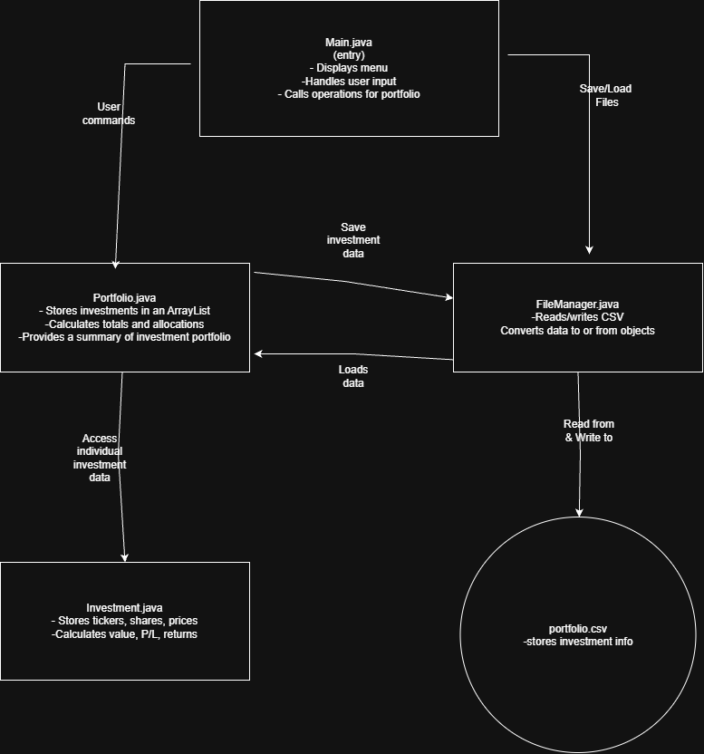

# Investorio

A Java terminal application that lets users manage their stock and index fund investments by recording their holdings, purchase prices, and current prices. It'll calculate their total portfolio value, profit/loss, percent returns, and the allocations of each investment. It'll also allow users to save and load their portfolio using CSV files.

## The Problem

Many investing brokerages such as Fidelity and Acorns have very convoluted statistics pages showing the performance of their portfolios.  Calculating the total value and gains/losses of each individual investments is very tedious as your portfolio grows. 
This application will allow users to record their investments and calculate their portfolio value, profit or loss, and allocations. You can also save your portfolio to a CSV file and load it again later.

## How It Works

Investorio is terminal-based program, driven by a menu. You enter each investment by manually (ticker, number of shares, purchase price per share, and current price per share), and the program does everything else.
 

 
| File | Responsibility |
|------|----------------|
| `Main.java` | Displays the menu, handles user input, and calls the other classes. |
| `Portfolio.java` | Stores investments in an `ArrayList`, calculates totals, allocations, sorts by value, searches by ticker, and prints the portfolio and summary. |
| `Investment.java` | Stores one holding (ticker, shares, purchase price, current price) and calculates its value, profit/loss, and percent return. |
| `FileManager.java` | Reads and writes the portfolio as a CSV file. |
| `portfolio.csv` | The saved portfolio. Created when you choose "Save Portfolio" in the menu. |
 
Invalid input never crashes the program. Letters where a number is expected, zero/negative shares, as well as negative prices all re-prompt. Malformed lines in a CSV file are skipped with a warning.

## Tech Stack

- **Language:** Java
- **IDE:** VS Code
- **Version Control:** Git & GitHub
- **Collection:** ArrayList for investment record storage
- **User Input:** Scanner for terminal input
- **Data Storage:** CSV Files
- **File Handling:** PrintWriter, File for reading and writing CSV files
- **Formatting:** NumberFormat
## Setup and Usage
 
### 1. Install Java
 
You need a JDK, version 11 or newer. Check whether you already have one:
 
```
javac -version
java -version
```

If either commands isn't found, install a JDK and reopen a new terminal.

### 2. Clone the repository

```
git clone https://github.com/jonathanzheng2020-eng/Investorio.git
cd Investorio
```

### 3. Compile and run
 
```
cd src
javac *.java
java Main
```

Also, `portfolio.csv` is saved to and loaded from the folder you run the program in, so always run it from the same folder (`src`).

### Example session
 
Adding an investment (menu option 1):
 
```
===== INVESTORIO =====
...
Enter your choice: 1
Ticker symbol (ex. AAPL): AAPL
Number of shares: 5
Purchase price per share: 180
Current price per share: 225
Added AAPL.
Value: $1,125.00
Profit/Loss: $225.00 (+25.00%)
```
 
After adding MSFT (2 shares, bought at $400, now $415) and NVDA (3 shares, bought at $120, now $145), viewing the portfolio (option 3):
 
```
Ticker       Shares    Buy Price   Curr Price          Value    Profit/Loss    Return Allocation
-------------------------------------------------------------------------------------------------
AAPL         5.0000      $180.00      $225.00      $1,125.00        $225.00   +25.00%     47.07%
MSFT         2.0000      $400.00      $415.00        $830.00         $30.00    +3.75%     34.73%
NVDA         3.0000      $120.00      $145.00        $435.00         $75.00   +20.83%     18.20%
```
 
Viewing the summary (option 4):
 
```
===== PORTFOLIO SUMMARY =====
Investments:     3
Total Invested:  $2,060.00
Total Value:     $2,390.00
Profit/Loss:     $330.00
Total Return:    +16.02%
```
 
Sorting by value (option 8):
 
```
Investments sorted by value:
 
AAPL   - $1,125.00
MSFT   - $830.00
NVDA   - $435.00
```
 
Searching by ticker (option 9):
 
```
Enter ticker to search: aapl
 
AAPL
Shares: 5
Current Value: $1,125.00
Profit/Loss: $225.00
```

### Menu options
 
| Option | Action |
|--------|--------|
| 1 | Add an investment |
| 2 | Remove an investment |
| 3 | View every investment with its value, profit/loss, return, and allocation |
| 4 | View portfolio totals |
| 5 | Save the portfolio to `portfolio.csv` |
| 6 | Load the portfolio from `portfolio.csv` (replaces current) |
| 7 | Exit (does not autosave) |
| 8 | Sort investments by current value, highest first |
| 9 | Search for investment by ticker |
 
### CSV format
 
```
ticker,shares,purchasePrice,currentPrice
AAPL,5.0,180.0,225.0
MSFT,2.0,400.0,415.0
NVDA,3.0,120.0,145.0
```
 
To load instantly, save the lines above as `portfolio.csv` in the `src` folder, run the program, and choose 6.

## Roadmap
 
- [x] Create the `Investment` class
- [x] Create the `Portfolio` class that stores investments
- [x] Calculate value, profit/loss, returns, and allocations
- [x] Build the terminal menu for adding, removing, and viewing investments
- [x] Save and load the portfolio using CSV files
- [x] Test normal inputs and edge cases (empty portfolio, missing file, invalid input)
- [x] Implement sorting/filtering to better navigate through investment portfolio
- [ ] Add a GUI
- [ ] Retrieve live prices using an API
- [ ] Display historical performance over time (your portfolio now vs. 10 years ago)
